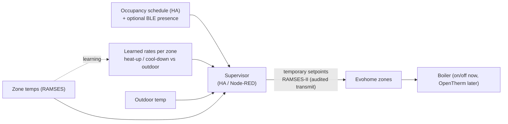

# Multi-Zone Supervisory Optimum Start/Stop over Evohome and RAMSES-II (Design Stage)

**A classic BMS supervisory function built on a home heating system: for each of ~18 zones, learn how fast the room heats and cools, then start heating just early enough to reach setpoint at the occupied time (optimum start) and set back just early enough to coast to the end of occupancy (optimum stop). Home Assistant / Node-RED is the supervisor; the two Honeywell Evohome systems execute, commanded locally over RAMSES-II radio. Results are measured against an on/off baseline before the OpenTherm stage builds on it.**

> **The short version:**
> - **When to heat** is decided per zone by learned **heat-up and cool-down rates** (°C/h, as a function of outdoor temperature), not by fixed schedule offsets.
> - **The supervisor** (HA/Node-RED) holds the occupancy schedule and sends **temporary zone setpoints** to Evohome over **RAMSES-II**: local, no cloud, through the already-audited transmit path.
> - **Evohome keeps** room control, its HR92s and the UFH. Its own optimisation is switched off so the two don't fight.
> - **Measured** against the plant-monitoring baseline: arrival accuracy (minutes early/late), heating hours, gas per degree-day.
> - **Then the OpenTherm stage builds on it:** a flow-temperature **boost** during preheat shortens heat-up, and the rates are re-learned.

**Delivery sequence:** A plant-monitoring baseline → **B optimum start/stop (this repo)** → D OpenTherm on the boiler (C, the rig exercises, runs in parallel). See the [portfolio hub](https://github.com/the-control-cabinet).

**Portfolio position:** Management/automation level · supervisory control. Related: [Evohome & RAMSES-II](https://github.com/the-control-cabinet/evohome-heating-controls-ramses-integration) · [Heating plant monitoring](https://github.com/the-control-cabinet/heating-plant-monitoring-esphome) · [OpenTherm control](https://github.com/the-control-cabinet/opentherm-boiler-control-esphome) · [BLE presence](https://github.com/the-control-cabinet/esp32-ble-presence-network) · [Energy dashboard](https://github.com/the-control-cabinet/home-energy-dashboard)

---

## Where it sits: the control hierarchy

| Layer | Decides | Delivered by |
|---|---|---|
| **Supervisory** | **When** each zone heats | **This repo** (HA/Node-RED → RAMSES-II) |
| Zone control | Whether each room needs heat now | Evohome (unchanged) |
| Plant control | How hard the boiler works | On/off today → [OpenTherm + PID](https://github.com/the-control-cabinet/opentherm-boiler-control-esphome) later |
| Measurement | What happened | [Plant monitoring](https://github.com/the-control-cabinet/heating-plant-monitoring-esphome), RAMSES, [energy dashboard](https://github.com/the-control-cabinet/home-energy-dashboard) |

## Documents

| Doc | Contents |
|---|---|
| [01 Scope and design](docs/01-scope-and-design.md) | Functions, inputs and outputs, Evohome settings, command path |
| [02 Learning model](docs/02-learning-model.md) | Rate estimation, data quality, per-zone parameters |
| [03 Algorithms](docs/03-algorithms.md) | Optimum start, optimum stop, limits, fall-backs |
| [04 Commissioning and measurement](docs/04-commissioning-and-measurement.md) | Tests, metrics, the baseline comparison |
| [05 Building on it with OpenTherm](docs/05-opentherm-integration.md) | Preheat boost, re-learning, interactions |

## Roadmap
- [ ] Baseline: per-zone heat-up and cool-down data from the plant-monitoring period (step A)
- [ ] Learning model running in "shadow mode": predicting start times, not acting
- [ ] Live on 2-3 zones (one UFH, two radiator), then all zones
- [ ] Measurement report vs the baseline
- [ ] Re-learn after OpenTherm; add the preheat boost (with the OpenTherm repo)

## Skills demonstrated (as built)
| Skill | Evidence |
|---|---|
| Supervisory control | Optimum start/stop across ~18 zones |
| Adaptive modelling | Learned heat-up/cool-down rates vs outdoor temperature |
| Integration | HA/Node-RED supervisor over RAMSES-II to two Evohome systems |
| Measurement and verification | Arrival accuracy and energy vs a baseline |
| Safe command authority | Audited transmit tier; shadow mode before acting |

📺 [The Control Cabinet on YouTube](https://www.youtube.com/channel/UC5Cupmz7vlfcodpCX7k8iuQ)

*Built and documented by James · part of [The Control Cabinet BMS portfolio](https://github.com/the-control-cabinet). MIT Licence.*
